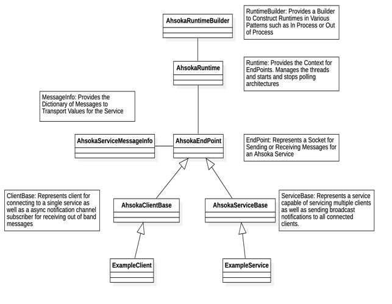

Understanding Ahsoka Service Architectures

Ahsoka Services provide an architecture to support creating functionality in your application that can be used in a wide variety of application architectures. As part of its design, we tried to achieve the following goals….

1.  Provide good encapsulation of your functionality and assist in providing a single / simple software API.
2.  Enable Cross Platform use of functionality by defining a set of messages (in the form of ProtoBuffer message objects) that can be consumed from numerous languages (C++, JS, etc.) while allowing you to implement functionality in one place.
1.  Allow you to integrate your functionality in a variety of network infrastructures such as when creating functionality for a single process, consuming functionality from a different process in the same machine, consuming your functionality in a container such as Docker, and consuming your functionality running on a separate machine boundary such as a multiple display or controller scenario.

Table of Contents

[Ahsoka Service Framework](#ahsoka-service-framework)

[Defining and Implementing your Service](#defining-and-implementing-your-service)

[Running your Service](#running-your-service)

[Ahsoka Service Scenarios](#ahsoka-service-scenarios-diagrams)

[Startup Scenario Diagram](#startup-scenario-diagram)

[Client and Service Scenario Diagram](#)

[Ahsoka Core Services](#ahsoka-core-services)

# Ahsoka Service Framework

At the core of the system is the Service Framework. Located in Ahsoka.Core.dll, this framework provides base or *abstract* classes to build the components which work together to implement a service for your system.

For an example of how to build an Ahsoka Service, download the Ahsoka.Demo.Services demo included in OpenPV Customer Toolkit.

## Defining and Implementing your Service

The implementation of your service is primarily completed by constructing 5 components consisting of a Service Configuration (code or file), Proto Definition File (.proto), a Message Info object, the Service, and the Client classes where you will write the code for your service.

**Configuration Files / Classes** – Services in Ahsoka consist of a client and service. These services typically use TCP to communicate however they can be configured to run inprocess as well. All Ahsoka Components can be configured by passing them a Service Configuration object. These objects may be compiled into your application or loaded from JSON. For each service you create, you must provide the unique addresses (typically different ports for TCP or names for Internal addresses) used for Connecting and Listening to your service. While services in the Ahsoka.Core framework will automatically configure to default addresses, you will need to provide default values for your services as shown in the Services demo. *Note that while Ahsoka Services do have default addresses, these CAN be overridden when constructing your clients if needed.*

**ProtoBuffer Definition Files** – All messages (which travel between clients and services) in an Ahsoka Service are represented using a Protocol Buffers V3 ‘.proto’ file. In this file, you define message objects for the data being sent or received from a service as well as a set of Transport ID’s which are used by our message framing system which enable us to route and decode your messages at each endpoint (client / service). If you are not familiar with Google Protocol Buffers, you can learn more about it here… <https://protobuf.dev>

**AhsokaServiceMessageInfo**: This object is a metadata dictionary of your service. It describes to our architecture the relationships between your objects and associates each object with a Transport ID. The TransportID’s are simply defined as an Enumeration in your ProtoBuffer Definition file. You accomplish this association by calling various registration methods (available on the AhsokaServiceMessageInfo base class) for the message pairs (for synchronous calls) or for single objects (for async notifications).

**AhsokaClientBase**: To create your client, you will inherit from the AhsokaClientBase object. Here you will create a client object to represent the functions used to interact with your service.

*In a traditional Test-Driven Development Model, you will often create this object (ClientBase) first, as it represents your public “API”, along with any tests which drive it.*

This client implementation is often the simplest part of your service as it normally is responsible only for routing messages to your service, however, the client object does offers you the opportunity to reshape or adapt your messages to your service if needed. This can be useful for backward compatibility or for simplification of the API with respect to the Service layer. For example, our Ahsoka CAN Service exposes a relatively “raw” byte array for CAN messages. To simplify this, we use a code generator to create classes each customer message, defined in DBC or using our Library Editor, enabling customers to interact with easy-to-use objects with more reliable and readable getter and setter functions. Our CAN client then reshapes this data to a more general **CANMessage** object with the raw byte[] values prior to sending messages to the service.

**AhsokaServiceBase**: The heart of your service is the service implementation where you will define the functionality of your service. Often this is designed in such a way as to provide hardware or even operating system abstraction and the complexity will depend on your needs.

*Ahsoka Services for example utilize a dependency injection system to select an implementation based on the current platform. The demo application shows a simple example of this by creating an object for Windows and Linux behind the service.*

This base service class exposes very few abstract functions and primarily is responsible for providing the Transport ID and decoded Message Object(s) to your Handler Implementation. You typically will handle each TransportID / Message object and return a response by replying when the work is done using sync return calls (using SendMessage) or async broadcasts (using SendNotification) calls.

## Running your Service

Once your service has been constructed, you will test it using one of the various execution systems in the Ahsoka Framework. Depending on the complexity of your application, you will use one of the following methods for starting and running your functionality.

**Startup with an AhsokaRuntime**: the lowest level of execution context is the AhsokaRuntime. A runtime is responsible for running and stopping any threads needed by the endpoint objects (note that both clients and services are endpoints) as part of program execution. Advanced applications such as those that need to communicate across a process boundary may wish to directly construct the runtimes for their application, however, **most applications should rely on one of the higher-level startup methods (Runtime Builders or Dispatchers) for their normal system processing as these abstractions take care of the most common scenarios needed for starting runtimes.**

**Startup with an AhsokaRuntimeBuilder**: The Runtime Builder is an implementation of a traditional Builder pattern which we use for starting runtimes with specific behaviors. The Builder provides the three most common startup methods.

-   Given a set of Client Objects, infer their services and start runtime(s) in the same process. (Most Common)
-   Given a set of Client Objects, infer their services, generate a configuration, and start runtime(s) in a separate process (Mostly for C++ Apps). This method uses Ahsoka.CommandLine to start and host the services.
-   Given a set of End Point Objects (clients or services), start a single runtime with only those endpoints that are specified (with no inference). This is used for scenarios such as when creating clients that talk to services on a different process or machine OR for starting services that will ONLY be consumed by another process or machine. Note that if your services are local or remote (most are) the inferred startups can be used.

Each of these scenarios have methods on the builder for configuring the system. The final build method ( StartWith\*) always results in a started runtime object which the customer application can maintain if needed. While this startup model works well in many scenarios, for many customer applications this does still require the developer to have a good understanding of system startup, threading, and concurrency. For this reason, we provide one more abstraction (Dispatcher) which is the recommended startup model for most customers.

**Startup with Dispatcher**: The Dispatcher object is a singleton (by default) object that enables a simple startup, shutdown, and execution context. In this startup architecture, customers can utilize a “Reactive” style of programming and let the Dispatcher take care of most of the startup, shutdown, and concurrency behaviors. By default, Dispatcher will…

1.  Auto Start All Runtimes needed by your system.
2.  Auto Starts All Async Message Handlers (Storyboard SBIO for example)
3.  Ensure that systemd notifications (Linux) occur just prior to the main loop.
4.  Block your main thread until the program exits.
5.  Receive all client notifications and dispatch them on your calling thread (to eliminate the need for most concurrency)
6.  Schedule Time Based Callbacks for clocks and periodic functionality. These callbacks also occur in your main thread to prevent the need to protect resources / manage concurrency in most scenarios.
7.  Manage Long Running Tasks with Callbacks (in main thread) when work is complete. This is useful for when you need to execute long running construction methods or to access remote resources and return success or failure OR the result of a construction / resource acquisition.
8.  Execute Clean Shutdowns in response to systemd stop requests.

For most users, the Dispatcher is the preferred runtime / startup model, however it is important to understand that the AhsokaRuntime and AhsokaRuntimeBuilder are available and are used internally by the Dispatcher behind the scenes for all startups and shutdowns.

# Ahsoka Service Scenarios Diagrams

The sequences below show a couple of the most common sequences that occur when interacting with services to help you better understand the flow of messages from client application to your service and back.

## Startup Scenario Diagram

In this first diagram, we show the object instantiation of a Service and Client along with their respective runtimes when using a typical Builder.StartWithInternalServices() method to start the system. *Note that when using Dispatcher, this orchestration still occurs simply behind the Dispatchers StartAndRun() method.*

## 

## Client and Service Scenario Diagram

In this sequence we show what interaction looks like between the App, Client, and Service during program execution. In the first flow below, the App registers for async callbacks (notifications) then calls a synchronous call named “GetTime” which sends a message to the service and waits for a reply.

In the second flow, the “SetTime” async call is executed to start a set time operation on an Implementation (likely a thread or other opaque implementation). When this work is completed, the service sends an out of band “Notification” to the client that then invokes the registered callback with the resulting data.

# Ahsoka Core Services

The Ahsoka.Core project contains several core services that are useful in most applications. The services currently available are listed below.

-   **System Service** – System service provides high level system functions such as changing brightness of an lcd, usb ports, sounding a buzzer, time and hardware information and other system level information.
    -   Note that much of this if information can be accessed behind the **SystemInfo** utility object which is used by both clients and services to access information about the Hardware Information (installed during prep).
-   **IOT Service** – This service provides the ability to act as an MQTT Client for common IOT service Brokers. Here you can connect, subscribe, and publish topics.
-   **Network Service** – This service provides low level control of networking facilities. This is primarily for configuring and interacting with WiFi capabilities.
    -   Note that there is a **WiFiManager** object that can cover most of the scenarios you may have for enumerating networks, connecting, and disconnecting from wireless networks. This manager object is compatible with Dispatcher and enables you to implement common UI’s without needing to handle the numerous calls needed to interact as a WiFi station.
-   **Install Service** – This service is responsible for executing installs in the Installer UI. It’s not typically consumed by client except in advanced scenarios.
-   **IO Service** – This service provides access to the raw IO values available in the system such as Analog and Digital Input and Output Values. Note that this service is currently in “Preview” as it will likely have changes in the 2.0 release timeframe.
-   **CAN Service** – This service provides the ability to define, send and receive RAW CAN and J1939 Messages in the system.
-   **Spark Service** – This service coordinates OTA Updates in the system. It enables checking for updates as well as managing downloads.
    -   Note that Spark and Network services are built into the Installer UI so do not need to be used in your application unless you with to do your own user experience for these capabilities.

# Ahsoka Language Considerations

**Building Services**

The Ahsoka.Core Service Components are currently supported in C\# using DotNet 7.0. As such, development of core libraries is easiest to implement is using C\#. Currently the Service Framework exists only in C\#. If integration technology is needed using C or C++ Libraries, C\# supports Native Interops to support bridging to low level compiled libraries. Many of the core libraries use this method including Storyboard, Networking and numerious system libraries on Linux and Windows.

**Building Clients**

While building Services is currently only supported with C\#, the Client Library components (AhsokaClientBase and AhsokaServiceMessageInfo) are supported in other languages. The following languages are supported or planned in future releases. These client libraries allow consuming Ahsoka Services (via the TCP Communication Layers) from other languages and technologies.

-   C++ on ST OpenView Displays: Support is available for C++ Client API’s for use in C++ CMAKE based projects.
-   Python Client Support: Support for Python Clients is planned for OpenPV 2.0
-   Node.JS Client Support: Support for Node.JS Clients is being considered for OpenPV 2.0.

While other languages may be considered in the future, the ProtoBuffer / NetMQ Communication layer used in the AhsokaServiceFramework can be adapted to a wide variety of other languages however no other languages are on the current roadmap.
